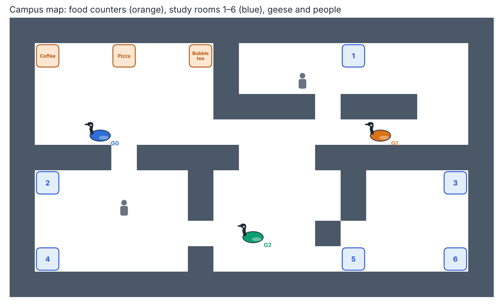
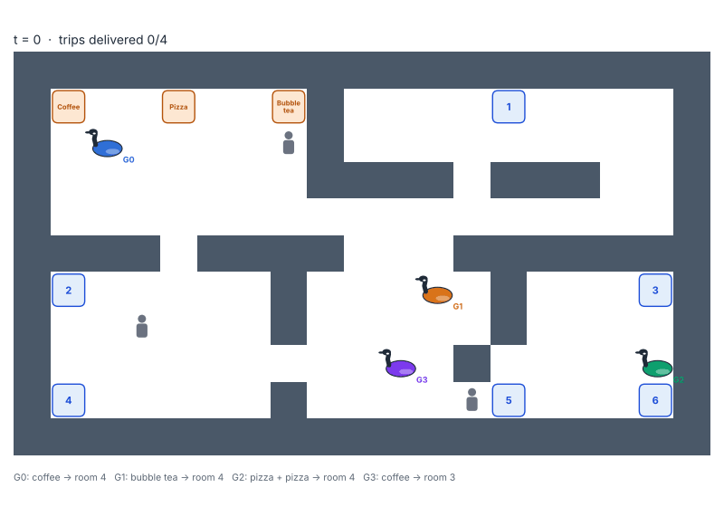
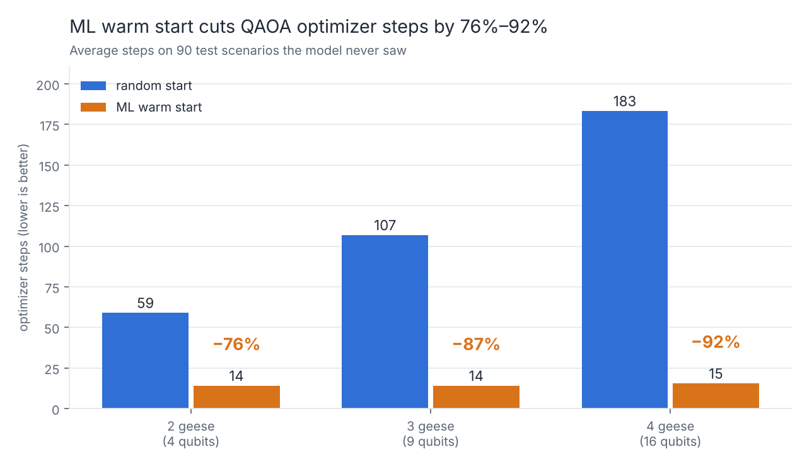

# QuarkQuacks 🪿

Robot geese that deliver food and drinks across campus, routed by a quantum algorithm.

## What it does

QuarkQuacks decides which robot goose delivers which order from the food court to study rooms. It solves the problem with QAOA, a quantum optimization algorithm, and uses machine learning to help QAOA find the answer faster.

## How it works

1. Generate geese and orders on a campus map.
2. Turn "which goose gets which order" into a QUBO, a problem format quantum computers can solve.
3. Solve it with QAOA in Qiskit, using ML to predict good starting settings.
4. Compare the result with a classical solver.

## Tech stack

Python, Qiskit, Qiskit Optimization, Qiskit Algorithms, Qiskit Aer, scikit-learn, pandas, NumPy, SciPy, Matplotlib, pytest

## How to run

```bash
git clone https://github.com/victoriatjhin/quarkquacks.git
cd quarkquacks
pip install -r requirements.txt
```

Then:

```bash
python run_pipeline.py --geese 3       # full pipeline on one scenario, saves a plan plot
python run_pipeline.py --geese 3 --bundle   # same, with nearby orders pre-bundled into one trip
python scripts/generate_data.py        # training data for 2-3 geese (about 30 s)
python scripts/generate_data.py --append --sizes 4 --n 150 --seed 4242   # add 4-goose data (about 12 min)
python -m ml.model                     # train the warm-start model
python -m ml.warmstart                 # compare random vs. warm-start QAOA
python scripts/plot_warmstart.py       # draw figures/warmstart.png
python scripts/scaling.py              # scaling study at 2-4 geese (about 1.5 min)
python scripts/plot_scaling.py         # draw figures/scaling.png
python demo/animate.py --geese 3       # collision-free delivery animation, figures/demo.gif
python demo/animate.py --geese 3 --bundle --out figures/demo_bundle.gif   # with pre-bundling
python demo/plot_map.py                # labelled campus map, figures/campus_map.png
python scripts/gpu_benchmark.py        # CPU vs. GPU QAOA timing at 4-25 qubits (needs qiskit-aer-gpu for GPU)
pytest                                 # all tests incl. integration (about 10 s)
pytest -m "not integration"            # skip the end-to-end checks
```

## Demo




Geese plan routes in first-come-first-served order, never share or swap cells, and wait for or step around people they sense within 2 cells.

**Pre-bundling** (`--bundle`): orders from the same counter whose rooms are at most 6 steps apart share one trip, so a goose can carry two orders. Trips are served first come, first served; later orders wait for the next round.



## Results

An ML model trained on 360 simulated scenarios predicts QAOA's starting angles, cutting the optimizer's work by 71–91% on 90 scenarios it never saw, with equal or better plans. Every QAOA plan is checked against an exact classical solver, and the routing layer delivered every order with zero collisions across 1,000 simulated runs. At this size the classical solver is exact and near-instant, so we don't claim a quantum advantage; the project shows a verifiable bridge from a real problem to QAOA and a way to make QAOA much cheaper to run.

| Geese (qubits) | Optimizer steps, random start | Optimizer steps, ML warm start | Reduction |
| --- | --- | --- | --- |
| 2 (4) | 49 | 14 | 71% |
| 3 (9) | 117 | 14 | 88% |
| 4 (16) | 189 | 16 | 91% |




**Pre-bundling:** the warm start transfers to bundled scenarios without retraining (68% / 88% / 93% fewer optimizer steps at 2 / 3 / 4 geese).

**Carpool mode** (branch `feature/carpool`): QAOA chooses which orders share a goose, with validation, repair and a classical fallback so every plan is valid. With 50 samples, QAOA finds the best plan directly 63% of the time vs. 40% for random guessing.

## Project structure

| Folder | Contents |
| --- | --- |
| `quarkquacks/` | Campus map, QUBO builder, classical solver, collision-free routes |
| `quantum/` | QAOA solver |
| `ml/` | ML model |
| `demo/` | Campus map, goose drawings, delivery animations |
| `data/`, `figures/` | Data, results, charts |
| `tests/` | Tests |
