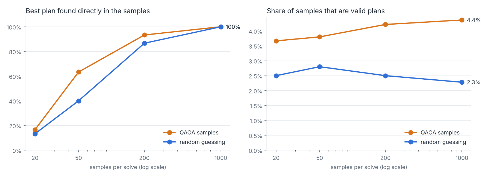

# QuarkQuacks 🪿

Robot geese that deliver food and drinks across campus, routed by a quantum algorithm.

## What it does

QuarkQuacks decides which robot goose delivers which order from the food court to study rooms. It solves the problem with QAOA, a quantum optimization algorithm, and uses machine learning to help QAOA find the answer faster.

## How it works

1. Generate geese and orders on a campus map.
2. Turn "which goose gets which order" into a QUBO, a problem format quantum computers can solve.
3. Solve it with QAOA in Qiskit, using ML to predict good starting settings.
4. Compare the result with a classical solver.

## Tech stack

Python, Qiskit, Qiskit Optimization, Qiskit Algorithms, Qiskit Aer, scikit-learn, pandas, NumPy, SciPy, Matplotlib, pytest

## How to run

```bash
git clone https://github.com/victoriatjhin/quarkquacks.git
cd quarkquacks
pip install -r requirements.txt
```

Then:

```bash
python run_pipeline.py                 # full pipeline, 4 geese: ML -> QAOA -> classical check -> collision-free delivery
python run_pipeline.py --bundle        # same, with nearby orders pre-bundled into one trip
python run_pipeline.py --carpool       # carpool mode: QAOA decides which orders share a goose (2 geese, 4 orders)
python run_pipeline.py --gif figures/run.gif   # any mode: also save the delivery animation
python run_pipeline.py --step-seconds 3        # show each order's wait time in minutes too
python scripts/generate_data.py        # training data for 2-3 geese (about 30 s)
python scripts/generate_data.py --append --sizes 4 --n 150 --seed 4242   # add 4-goose data (about 12 min)
python -m ml.model                     # train the warm-start model
python -m ml.warmstart                 # compare random vs. warm-start QAOA
python scripts/plot_warmstart.py       # draw figures/warmstart.png
python scripts/scaling.py              # scaling study at 2-4 geese (about 1.5 min)
python scripts/plot_scaling.py         # draw figures/scaling.png
python demo/animate.py                 # collision-free delivery animation (4 geese), figures/demo.gif
python demo/animate.py --bundle --out figures/demo_bundle.gif   # with pre-bundling
python demo/plot_map.py                # labelled campus map, figures/campus_map.png
python scripts/gpu_benchmark.py        # CPU vs. GPU QAOA timing at 4-25 qubits (needs qiskit-aer-gpu for GPU)
python scripts/carpool_eval.py         # carpool mode: QAOA vs. random guessing (about 1 min)
python -m quantum.quantum_benchmark    # real Qiskit QAOA, warm vs. random start; set max_n=4 for the full test set (about 20 min)
pytest                                 # all tests incl. end-to-end integration (about 1 min)
pytest -m "not integration"            # skip the end-to-end checks
```

## Demo


Geese plan routes in first-come-first-served order, never share or swap cells, and wait for or step around people they sense within 2 cells.

**Wait-time counter:** every run prints how long each order waited, from being placed to being dropped off at its room, plus the average and longest wait. The animation shows a live counter per order that stops with a ✓ on delivery.

**Pre-bundling** (`--bundle`): orders from the same counter whose rooms are at most 6 steps apart share one trip, so a goose can carry two orders. Trips are served first come, first served; later orders wait for the next round.


## Results

Every QAOA plan is checked against an exact classical solver, and the routing layer delivered every order with zero collisions across 1,000 simulated runs. At this size the classical solver is exact and near-instant, so we don't claim a quantum advantage; the project shows a verifiable bridge from a real problem to QAOA.

**Cost = walking steps x priority.** With plain walking distance, many scenarios had several equally good plans (every plan tied in 63% / 48% / 21% of 2 / 3 / 4-goose scenarios), because the counter-to-room leg costs the same whichever goose walks it. Weighting each order by its arrival priority (first come = highest) leaves one best plan in 94% / 88% / 88% of scenarios, so the model learns from real differences between plans.

**ML warm start.** A random forest trained on 360 scenarios predicts QAOA's starting angles (angle error 0.056 vs. 0.59 for k-nearest neighbours). On 90 scenarios it never saw, in our fast NumPy QAOA simulation:

| Geese (qubits) | Optimizer steps, random start | Optimizer steps, ML warm start | Reduction |
| --- | --- | --- | --- |
| 2 (4) | 59 | 14 | 76% |
| 3 (9) | 107 | 14 | 87% |
| 4 (16) | 183 | 15 | 92% |


**In real Qiskit QAOA** (`quantum/quantum_benchmark.py`, same 90 test scenarios, `data/quantum_benchmark.csv`), the saving is much smaller, because Qiskit's optimizer settles in about 25-30 steps from any start: 24 vs. 29 steps at 2 geese (18% fewer), 28 vs. 29 at 3 (6%), 29 vs. 29 at 4 (2%). Up to 9 qubits the solver always returns the best plan. At 16 qubits QAOA returns the single best plan 30% of the time (random start: 37%), but every plan it returned in a 10-scenario check was valid, on average 2.1% above the best, and within 5% of it 90% of the time. The safety check flags any gap, and an invalid plan is never sent out.


**Pre-bundling:** the warm start transfers to bundled scenarios without retraining (74% / 87% / 91% fewer optimizer steps at 2 / 3 / 4 geese in the fast simulation).

**Carpool mode:** QAOA chooses which orders share a goose, with validation, repair and a classical fallback so every plan is valid. With 50 samples, QAOA finds the best plan directly 63% of the time vs. 40% for random guessing.



## Project structure

| Folder | Contents |
| --- | --- |
| `quarkquacks/` | Campus map, QUBO builder, classical solver, collision-free routes, carpool mode |
| `quantum/` | QAOA solver |
| `ml/` | ML model |
| `demo/` | Campus map, goose drawings, delivery animations |
| `data/`, `figures/` | Data, results, charts |
| `tests/` | Tests |
