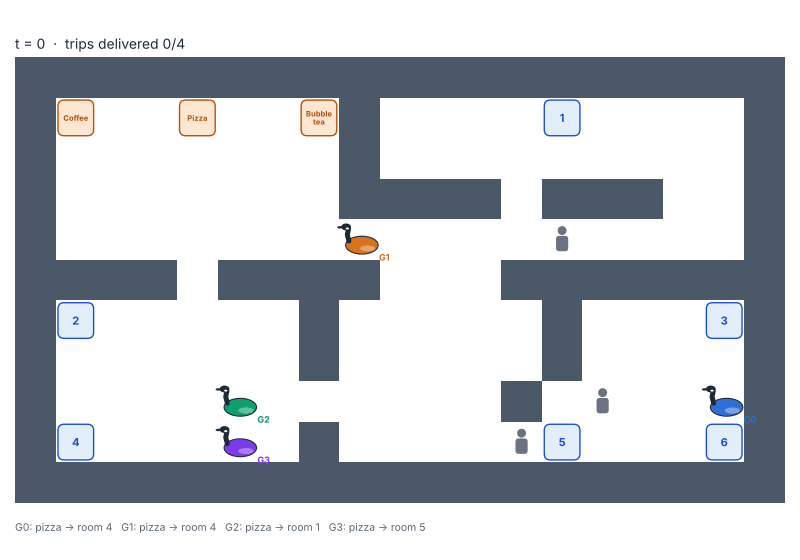
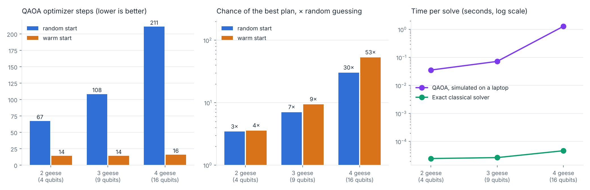

# QuarkQuacks 🪿

Robot geese that deliver food and drinks across campus, routed by a quantum algorithm.

## What it does

QuarkQuacks decides which robot goose delivers which order from the food court to study rooms. It solves the problem with QAOA, a quantum optimization algorithm, and uses machine learning to help QAOA find the answer faster.

## How it works

1. Generate geese and orders on a campus map.
2. Turn "which goose gets which order" into a QUBO, a problem format quantum computers can solve.
3. Solve it with QAOA in Qiskit, using ML to predict good starting settings.
4. Compare the result with a classical solver.

## Tech stack

Python, Qiskit, Qiskit Optimization, Qiskit Aer, scikit-learn, NumPy, SciPy, Matplotlib

## How to run

```bash
git clone https://github.com/victoriatjhin/quarkquacks.git
cd quarkquacks
pip install -r requirements.txt
```

Then:

```bash
python run_pipeline.py --geese 3       # full pipeline on one scenario, saves a plan plot
python scripts/generate_data.py        # training data for 2-3 geese (about 30 s)
python scripts/generate_data.py --append --sizes 4 --n 150 --seed 4242   # add 4-goose data (about 12 min)
python -m ml.model                     # train the warm-start model
python -m ml.warmstart                 # compare random vs. warm-start QAOA
python scripts/scaling.py              # scaling study at 2-4 geese (about 1.5 min)
python scripts/plot_scaling.py         # draw figures/scaling.png
python demo/animate.py --geese 3       # collision-free delivery animation, figures/demo.gif
python scripts/gpu_benchmark.py        # CPU vs. GPU QAOA timing at 4-25 qubits (needs qiskit-aer-gpu for GPU)
pytest                                 # all tests incl. integration (about 1.5 min)
pytest -m "not integration"            # quick tests only (a few seconds)
```

## Demo



Geese plan routes in first-come-first-served order, never share or swap cells, and wait for or step around people they sense within 2 cells.



## Project structure

| Folder | Contents |
| --- | --- |
| `quarkquacks/` | Campus map, QUBO builder, classical solver, collision-free routes |
| `quantum/` | QAOA solver |
| `ml/` | ML model |
| `demo/` | Goose animation |
| `data/`, `figures/` | Data, results, charts |
| `tests/` | Tests |
